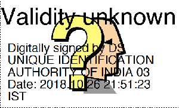
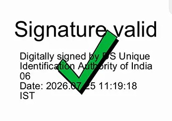
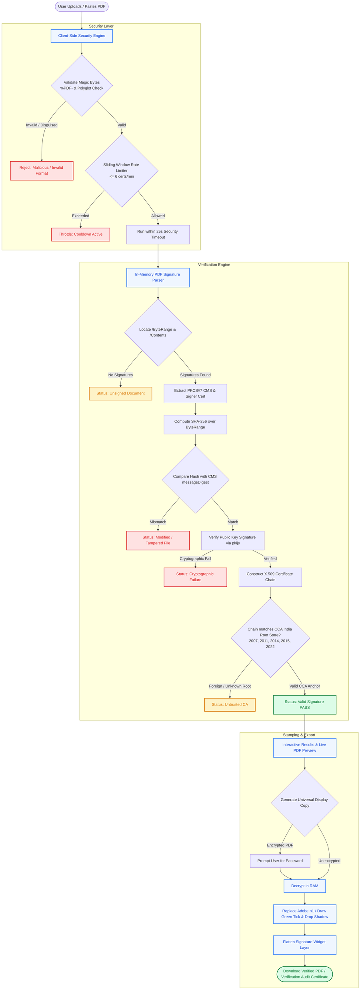
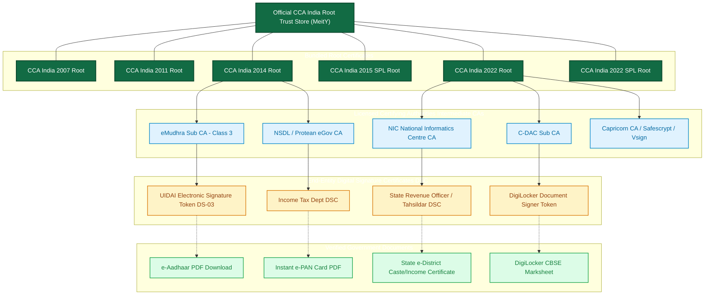

# SignValid 🇮🇳 — Indian Digital Signature Verification Engine

[](LICENSE)
[](https://react.dev)
[](https://www.typescriptlang.org)
[](https://vitejs.dev)
[-126B44)](https://cca.gov.in)
[](https://www.signvalid.in)

**SignValid** is a high-performance, 100% client-side web application designed to validate Indian government digitally signed PDF documents against the official **Controller of Certifying Authorities (CCA)** root trust store under India's **Information Technology Act, 2000**.

It permanently fixes the notorious Adobe Acrobat **`? Validity Unknown`** warning by verifying cryptographic signatures and generating an authentic universal display copy embedded with a permanent **`✓ Signature Valid`** green checkmark—viewable on mobile phones, web browsers, and paper printouts.

<table>
  <tr>
    <td align="center">
      
    </td>
    <td align="center">
      <strong style="font-size: 40px;">────────────────→</strong>
    </td>
    <td align="center">
      
    </td>
  </tr>
</table>

---

## 📌 Table of Contents

- [The Problem: Why Adobe Shows "Validity Unknown"](#-the-problem-why-adobe-shows-validity-unknown)
- [Key Features & Capabilities](#-key-features--capabilities)
- [Architecture & Verification Flowcharts](#-architecture--verification-flowcharts)
  - [1. End-to-End Verification & Stamping Pipeline](#1-end-to-end-verification--stamping-pipeline)
  - [2. PKI Trust Chain Hierarchy](#2-pki-trust-chain-hierarchy)
- [Security Architecture & Privacy](#-security-architecture--privacy)
  - [Zero-Data Retention (Client-Side Memory Only)](#zero-data-retention-client-side-memory-only)
  - [Input Sanitization & Polyglot Defense](#input-sanitization--polyglot-defense)
  - [Cryptographic DoS & Timeout Protection](#cryptographic-dos--timeout-protection)
  - [Sliding-Window Rate Limiter](#sliding-window-rate-limiter)
  - [Encrypted Document Handling](#encrypted-document-handling)
- [Supported Documents & Authorities](#-supported-documents--authorities)
- [Tech Stack](#-tech-stack)
- [Project Directory Structure](#-project-directory-structure)
- [Getting Started](#-getting-started)
- [Testing with Sample Documents](#-testing-with-sample-documents)
- [Legal & Disclaimer](#-legal--disclaimer)

---

## ⚠️ The Problem: Why Adobe Shows "Validity Unknown"

When citizens open legitimate government PDFs (e-Aadhaar, e-PAN, caste/income certificates, court orders) in standard PDF viewers such as Adobe Acrobat Reader, they often see a yellow question mark:

$$\boxed{\mathbf{? \quad Validity \ Unknown}}$$

### Why does this happen?
1. **Adobe Approved Trust List (AATL) Disconnect**: Adobe maintains a proprietary commercial trust list. Indian government root certificates issued by the **Controller of Certifying Authorities (CCA)** are typically not included in Adobe's default trust store out of the box.
2. **Missing Local Trust Anchors**: Unless an end-user manually downloads, imports, and configures `.cer` trust anchors for CCA India (2007, 2011, 2014, 2015 SPL, and 2022) into Adobe's local certificate store, Acrobat cannot validate the issuer path.
3. **Printouts & Mobile Viewers Strip Digital Validation**: When printed on paper or viewed on mobile browsers (which lack PKCS#7 signature parsers), the document appears unverified or shows an unresolved question mark.

**SignValid solves this** by executing mathematical cryptographic signature verification directly in the browser and producing a permanent, flattened visual display copy featuring an authentic Adobe-style green checkmark with 3D drop-shadow.

---

## 🚀 Key Features & Capabilities

### 1. In-Browser Cryptographic Engine
- **Direct `/ByteRange` & `/Contents` Parsing**: Extracts embedded PKCS#7 / CMS signatures without sending file bytes across the network.
- **Message Digest Integrity Check**: Calculates SHA-256 (or SHA-1, SHA-384, SHA-512) digests over the exact signed byte ranges and compares against the authenticated CMS `messageDigest` attribute.
- **Cryptographic Signature Validation**: Verifies RSA (1024/2048/4096-bit) and ECDSA signatures using standard Web Crypto APIs and `pkijs`.
- **Full X.509 Certificate Chain Resolution**: Reconstructs the complete certificate hierarchy (End-Entity Certificate $\rightarrow$ Intermediate Sub-CA $\rightarrow$ Official CCA India Root CA).
- **Certificate Validity Window**: Assesses whether signatures were generated within the authorized certificate lifetime (`notBefore` to `notAfter`).
- **Incremental Update Detection**: Detects whether modifications were made after signing (`coversWholeDocument` integrity verification).

### 2. Universal Display Copy Generator ("Green Tick Stamper")
- **Visual Signature Replacement**: Locates existing signature widgets (legacy Adobe `n1` appearance layer) and updates the visual indicator to an authentic **`✓ Signature Valid`** vector checkmark.
- **Sub-Pixel Adobe Checkmark Recreation**: Precision-rendered green checkmark (`#00A651`) with authentic black 3D drop-shadow.
- **Vector & Formatting Preservation**: Maintains 100% of the original document layout, typography, resolution, and vector assets.
- **Encrypted / Password-Protected PDF Support**: Supports password-unlocking for protected documents (e.g., e-Aadhaar birth year passwords) using `@cantoo/pdf-lib`.

### 3. Verification Audit Certificate Generator
- Generates a standalone, court-admissible PDF **Digital Signature Verification Certificate** detailing:
  - Document SHA-256 cryptographic fingerprint
  - Signer Organization & Common Name (CN)
  - Issuing Certifying Authority (CA)
  - Signing timestamp in Indian Standard Time (IST)
  - Hash & signature algorithm details
  - CCA India root anchor confirmation

### 4. Interactive Live PDF Previewer
- Side-by-side or toggleable preview comparing:
  - **Before**: Adobe reader view with yellow `? Validity Unknown`
  - **After**: SignValid universal display copy with crisp green `✓`
- Built using `pdfjs-dist` for real-time in-browser rendering.

### 5. Multi-File Processing & Clipboard Paste
- Drag and drop multiple government PDFs simultaneously (up to 25 MB per file).
- Instant clipboard paste support (`Ctrl + V` anywhere on the screen).

### 6. Interactive Sample Playground
- Includes 5 pre-configured real-world test cases:
  1. `e-Aadhaar (UIDAI DS-03)` — Valid signature chaining to CCA 2014 Root.
  2. `Karnataka Seva Sindhu (Income Certificate)` — Valid state DSC chaining to CCA 2022 Root.
  3. `DigiLocker CBSE Class XII Marksheet` — Valid National Academic Depository signature.
  4. `Tampered / Altered Document` — Integrity check failure demonstration (SHA-256 mismatch).
  5. `Unsigned Scan Document` — Plain scanned document without PKCS#7 envelope.

---

## 📊 Architecture & Verification Flowcharts

### 1. End-to-End Verification & Stamping Pipeline



---

### 2. PKI Trust Chain Hierarchy



---

## 🔒 Security Architecture & Privacy

SignValid incorporates an enterprise-grade defense-in-depth model specifically tuned for processing sensitive citizen documents (Aadhaar cards, tax returns, land records):

### Zero-Data Retention (Client-Side Memory Only)
- **No Server Processing**: All cryptographic digest computations, ASN.1 parsing, and PDF modifications occur inside the client's browser engine using Web Crypto APIs and WebAssembly.
- **RAM Ephemeral Buffers**: Documents are stored in transient `Uint8Array` memory buffers. No data is stored in `localStorage`, `sessionStorage`, cookies, or remote databases.
- **Instant Garbage Collection**: Upon resetting or closing the browser tab, all allocated buffers are immediately discarded.

### Input Sanitization & Polyglot Defense
*Implemented in [`src/security/sanitizer.ts`](file:///e:/coding/Valid%20signature/src/security/sanitizer.ts)*:
- **Magic Byte Inspection (`validatePdfBytes`)**: Inspects the first 1,024 bytes of uploaded files to confirm legitimate `%PDF-` file headers.
- **Polyglot & Script Attack Shielding**: Blocks disguised polyglot payloads (e.g., HTML, XML, or SVG files masquerading as PDFs with tags such as `<script>`, `<html>`, or `<!DOCTYPE>`).
- **Stored DOM XSS Prevention (`sanitizeCertString`)**: Strips non-printable ASCII control characters (`\x00-\x1F`) and HTML-escapes (`<`, `>`, `&`, `"`, `'`) all metadata parsed from untrusted X.509 certificate fields (Common Name, Organization, Organizational Unit).

### Cryptographic DoS & Timeout Protection
- **Timeout Watchdog (`runWithSecurityTimeout`)**: Wraps intensive cryptographic algorithms and PDF decompaction routines in an asynchronous 25-second watchdog timer.
- **Decompression Bomb Mitigation**: Automatically halts processing and releases memory if an adversary submits a malicious recursive PDF stream or parser bomb.

### Sliding-Window Rate Limiter
*Implemented in [`src/security/rateLimiter.ts`](file:///e:/coding/Valid%20signature/src/security/rateLimiter.ts)*:
- **Action Throttling**: Enforces a minimum 1,000 ms cooldown between consecutive verification actions to prevent browser main-thread locking.
- **Sliding-Window Quota**: Limits batch verification to a maximum of **6 certificates per 60-second window**. Excess files are queued or safely throttled with clear user feedback.

### Encrypted Document Handling
- **Password Isolation (`sanitizeDocumentPassword`)**: Sanitizes PDF password input, limits length to 64 characters, and removes dangerous shell/newline escapes.
- **Ephemeral Decryption**: Password-protected PDFs (such as UIDAI password-protected e-Aadhaar cards) are decrypted strictly in RAM; unencrypted copies are never transmitted externally.

---

## 📂 Supported Documents & Authorities

### 1. Supported Document Categories

| Category | Example Documents | Issuing Authorities & Portals |
| :--- | :--- | :--- |
| **Identity & Tax** | e-Aadhaar, Masked Aadhaar, Instant e-PAN, e-Passport confirmation | UIDAI, Protean NSDL, UTIITSL, Income Tax Dept, MEA |
| **State e-District Services** | Income, Caste, Domicile, Birth, Death, First Graduate, Legal Heir certificates | Seva Sindhu (KA), TNeGA / e-Sevai (TN), e-District (KL, UP, DL), Aaple Sarkar (MH) |
| **Digital Repositories** | DigiLocker issued documents, CBSE digital marksheets, University degrees | National Academic Depository (NAD), DigiLocker |
| **Revenue & Judiciary** | e-Courts orders & judgments, Land records (Patta/Chitta, RoR, Khata), Sale deeds | High Courts, District Courts, Land Revenue Departments |

### 2. Accredited Certifying Authorities (CCA India)

SignValid bundles and verifies against root keys used by all licensed Indian CAs:
- **eMudhra** (eMudhra Sub CA - Class 3)
- **National Informatics Centre (NIC)** (NIC Sub CA)
- **NSDL / Protean eGov Technologies**
- **C-DAC** (Centre for Development of Advanced Computing)
- **Capricorn CA**
- **Safescrypt** (Sify Technologies)
- **Vsign** (Verasys Technologies)
- **IDRBT** (Institute for Development and Research in Banking Technology)
- **Pantagon Sign**

---

## 💻 Tech Stack

- **Frontend Core**: [React 19](https://react.dev) + [TypeScript 6](https://www.typescriptlang.org)
- **Build Tooling**: [Vite 8](https://vitejs.dev) + [Oxlint](https://oxc.rs)
- **Cryptography & ASN.1 Parsing**:
  - [`pkijs`](https://github.com/PeculiarVentures/PKI.js) — In-browser X.509 and PKCS#7 / CMS cryptographic validation.
  - [`asn1js`](https://github.com/PeculiarVentures/ASN1.js) — Binary ASN.1 BER/DER decoding.
- **PDF Manipulation & Rendering**:
  - [`@cantoo/pdf-lib`](https://cantoo-scribe.github.io/pdf-lib/) — Low-level PDF object tree parsing, stream manipulation, and vector checkmark stamping.
  - [`pdfjs-dist`](https://mozilla.github.io/pdf.js/) — High-fidelity client-side PDF preview rendering.
  - [`jspdf`](https://github.com/parallax/jsPDF) — Verification audit certificate generation.
- **UI & UX**:
  - [`lucide-react`](https://lucide.dev) — Modern clean icons.
  - [`canvas-confetti`](https://github.com/catdad/canvas-confetti) — Verification celebration micro-interactions.
  - Custom Vanilla CSS Design System with responsive mobile layout and accessibility tokens.

---

## 📁 Project Directory Structure

```text
Valid signature/
├── public/                     # Static public assets & root icons
├── src/
│   ├── certs/                  # Official CCA India Root Certificates
│   │   ├── CCAIndia2007.cer    # CCA Root 2007 DER
│   │   ├── CCAIndia2011.cer    # CCA Root 2011 DER
│   │   ├── CCAIndia2014.cer    # CCA Root 2014 DER
│   │   ├── CCAIndia2015SPL.cer # CCA Root 2015 Special DER
│   │   ├── CCAIndia2022.cer    # CCA Root 2022 4096-bit DER
│   │   ├── CCAIndia2022SPL.cer # CCA Root 2022 Special DER
│   │   └── ccaRoots.ts         # Base64 compiled trust store registry
│   ├── components/             # UI Components
│   │   ├── AboutPage.tsx       # About SignValid & mission statement
│   │   ├── AuthoritiesPage.tsx # List of CCA licensed certifying authorities
│   │   ├── CookieBanner.tsx    # Privacy-first anonymous cookie consent
│   │   ├── DocumentsPage.tsx   # Searchable supported documents directory
│   │   ├── Dropzone.tsx        # Drag & drop upload area + paste listener
│   │   ├── FaqPage.tsx         # Interactive FAQ accordion
│   │   ├── Footer.tsx          # Multi-column footer & statutory disclaimer
│   │   ├── GuidesPage.tsx      # Fix Adobe / e-Aadhaar guides
│   │   ├── Header.tsx          # Navigation header & brand badge
│   │   ├── Hero.tsx            # Hero section with value propositions
│   │   ├── HowItWorksPage.tsx  # Architectural explainer & visual diagrams
│   │   ├── PdfLivePreview.tsx  # Side-by-side Before/After PDF.js viewer
│   │   ├── ReportModal.tsx     # Technical certificate chain & hash inspection
│   │   ├── ResultsCard.tsx     # Verification results & download action card
│   │   ├── StatsModal.tsx      # Social proof & metrics modal
│   │   ├── term&cond.tsx       # Legal Terms & Conditions (IT Act 2000)
│   │   ├── Toast.tsx           # Floating toast notification system
│   │   └── VerificationProgress.tsx # Real-time loading progress indicator
│   ├── data/                   # Static registry data & sample test suites
│   │   ├── authorities.ts      # Certifying authorities directory
│   │   ├── faqData.ts          # Comprehensive FAQ items
│   │   ├── sampleDocuments.ts  # Preloaded sample PDFs (Aadhaar, Seva Sindhu, etc.)
│   │   └── supportedDocs.ts    # Comprehensive catalog of supported documents
│   ├── security/               # Security Engine & Safeguards
│   │   ├── rateLimiter.ts      # Sliding-window rate limiter (6 certs/min)
│   │   └── sanitizer.ts        # Magic byte check, XSS sanitizer, security timeouts
│   ├── utils/
│   │   └── pdfGenerator.ts     # jsPDF verification audit report generator
│   ├── verify/                 # Core Cryptography & PDF Engines
│   │   ├── stampPdf.ts         # Vector checkmark replacement & layer flattening
│   │   └── verifyPdf.ts        # PKCS#7 extraction, SHA-256 digest, & CCA chain check
│   ├── App.tsx                 # Root application container & view router
│   ├── index.css               # Modern design system & CSS variables
│   ├── main.tsx                # React entry point
│   └── types.ts                # TypeScript interfaces and status types
├── index.html                  # HTML template with SEO meta tags
├── package.json                # Dependencies & npm scripts
├── plan.md                     # Architecture specification document
├── tsconfig.json               # TypeScript compiler configuration
└── vite.config.ts              # Vite configuration
```

---

## 🛠️ Getting Started

### Prerequisites
- [Node.js](https://nodejs.org) (v18.0.0 or higher recommended)
- [npm](https://www.npmjs.com) (v9.0.0 or higher)

### Installation
1. Clone the repository:
   ```bash
   git clone https://github.com/Gongchampou/SignvalidGov.git
   cd "Valid signature"
   ```

2. Install dependencies:
   ```bash
   npm install
   ```

3. Start the local development server:
   ```bash
   npm run dev
   ```
   Open your browser and navigate to `http://localhost:5173`.

### Production Build & Linting
- **Build**:
  ```bash
  npm run build
  ```
  The compiled static distribution files will be generated in `dist/`.

- **Lint**:
  ```bash
  npm run lint
  ```

---

## 🧪 Testing with Sample Documents

Don't have an Indian government PDF on hand? You can test SignValid immediately using the built-in sample suite on the homepage:

1. Scroll to the **"Try with a sample government document"** section in the upload box.
2. Click any of the test cards:
   - **`e-Aadhaar (UIDAI DS-03)`**: Demonstrates a valid UIDAI certificate chaining to CCA 2014.
   - **`Karnataka Seva Sindhu`**: Demonstrates state e-District certificate verification.
   - **`DigiLocker Marksheet`**: Demonstrates digital repository signature validation.
   - **`Tampered / Altered File`**: Demonstrates automated detection of hash digest failure.
   - **`Unsigned Scan`**: Demonstrates unsigned PDF detection.
3. Inspect the live status, view the cryptographic certificate chain modal, and test generating the universal display copy!

---

## ⚖️ Legal & Statutory Disclaimer

1. **Independent Utility**: SignValid is an independent cryptographic verification tool. It is not affiliated with, endorsed by, or operated by UIDAI, the Ministry of Electronics and Information Technology (MeitY), the Controller of Certifying Authorities (CCA), or any state government portal.
2. **Statutory Reference**: Verification criteria adhere to Sections 3 and 35 of the **Information Technology Act, 2000** (India) governing electronic signatures and accredited certifying authorities.
3. **Display Copy vs. Digital Signature**: The downloaded universal display copy contains an updated visual indicator for easy verification across all PDF readers, mobile devices, and physical paper prints. For legal filings that require direct cryptographic signature introspection, always retain and submit the original signed PDF alongside the SignValid audit report.

---

<p align="center">
  Made for citizens, verifiers, and institutions across India 🇮🇳
</p>
