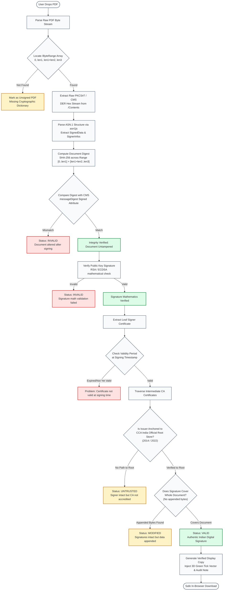

# SignValid Security Architecture & Threat Defense

> **Classification:** Comprehensive Technical Security Documentation  
> **Target System:** SignValid (Universal Indian Digital Signature Validator & Stamping Engine)  
> **Architecture Model:** 100% Client-Side In-Memory (Zero-Trust / Zero-Knowledge)  
> **Regulatory Adherence:** Information Technology Act, 2000 (Republic of India) · ISO 32000-1 · RFC 5280 · RFC 3161  

---

## 1. Executive Summary & Core Security Guarantees

SignValid is architected from the ground up on a **Zero-Knowledge, 100% Ephemeral Client-Side** execution paradigm. Traditional document verification portals upload user documents to centralized servers, introducing critical attack surfaces including cloud data breaches, man-in-the-middle interception, unauthorized telemetry, and permanent database retention of sensitive citizen records (e-Aadhaar, PAN cards, income and caste certificates).

SignValid eliminates the server from the security boundary entirely:

```
[ User Browser / Device ] <====== No Server Uploads ======> [ External Internet ]
         │
         ├── 1. In-Memory Ephemeral RAM Processing
         ├── 2. Native WebCrypto & PKI.js Cryptography
         ├── 3. Bundled CCA India Official Root Store
         └── 4. Ephemeral Garbage Collection on Reset
```

### Core Security Tenets:
1. **Zero Remote Transmission:** PDF bytes are never transmitted across the network. All parsing, hashing, signature validation, and PDF stamping execute locally within the browser engine.
2. **Zero Disk / Storage Persistence:** Documents, private certificates, signatures, and document passwords are never written to `localStorage`, `sessionStorage`, `IndexedDB`, WebSQL, or cookies.
3. **Hardware-Accelerated WebCrypto:** SHA-256 digests and RSA/ECDSA mathematical operations execute via browser native `window.crypto.subtle` primitives.
4. **Strict Isolation & Outbound Blocking:** A strict Content Security Policy (CSP) with `connect-src 'self' ws: wss:` and `object-src 'none'` prevents unauthorized network exfiltration.

---

## 2. Threat Modeling & Cyber Attack Surface Analysis

The following threat matrix documents all audited cyber attack vectors, potential hacker exploits, and SignValid's corresponding defense-in-depth countermeasures:

| Threat Category | Potential Attack Vector / Exploit | Risk Level | SignValid Defense & Countermeasure | Implementation Reference |
| :--- | :--- | :---: | :--- | :--- |
| **Data Exfiltration** | Malicious browser extension, supply-chain attack, or rogue third-party script exfiltrating uploaded government documents. | **Critical** | Zero network transmission architecture; strict Content-Security-Policy (CSP) blocking external outbound network requests (`connect-src`); strictly ephemeral memory buffers. | `index.html`<br>`src/App.tsx` |
| **Polyglot & File Masquerading** | Hacker uploads HTML, PHP, shell scripts, or executable binaries masquerading with `.pdf` extension to exploit browser parsers. | **High** | Multi-tier file inspection: MIME type checking, 1024-byte magic byte detection (`%PDF-`), rejection of HTML/XML/script tokens in file header. | `src/security/sanitizer.ts`<br>`validatePdfBytes()` |
| **Stored DOM XSS** | Adversary crafts a fraudulent certificate with embedded JavaScript payloads in X.509 fields (e.g. `CN=<script>alert(1)</script>`). | **High** | Mandatory input sanitization stripping ASCII control codes (`\x00-\x1F`), encoding HTML entities (`<>&"'`), and React virtual DOM automatic escaping. | `src/security/sanitizer.ts`<br>`sanitizeCertString()` |
| **Denial of Service (DoS / ReDoS)** | Maliciously crafted PDF with recursive dictionary loops, zip compression bombs, or endless cross-reference tables causing tab freeze. | **Medium** | Strict 25-second operation timeout promise wrapper; 25 MB file size limit; recursive depth boundaries on ASN.1 parsing and appearance streams. | `src/security/sanitizer.ts`<br>`runWithSecurityTimeout()` |
| **Client-Side Abuse & Brute-Force** | Automated scripts or bots rapidly testing passwords or flooding local execution to cause browser crashes. | **Medium** | Sliding-window rate limiter enforcing 1,000ms minimum interval throttle and a maximum of 6 certificate verifications per 60-second window. | `src/security/rateLimiter.ts`<br>`securityRateLimiter` |
| **Clickjacking / UI Redressing** | Adversarial website embeds SignValid in a transparent `<iframe>` to trick users into dragging files or authorizing downloads. | **Medium** | Strict `X-Frame-Options: DENY`, `frame-ancestors 'none'` in CSP, and real-time inline JavaScript anti-clickjacking framebuster defense. | `index.html`<br>`#antiClickjack` |
| **Cryptographic Signature Forgery** | Attacker tampers with document content while preserving the signature block or forging untrusted root certificates. | **Critical** | Exact byte-range digest verification against PKCS#7 `messageDigest`; public key signature verification; hierarchical certificate path chaining to official CCA India 2014 & 2022 roots. | `src/verify/verifyPdf.ts`<br>`verifyOne()`, `buildChain()` |
| **Path Traversal / Filename Injection** | Malicious PDF naming (e.g. `../../payload.exe` or `%00evil.pdf`) exploiting browser file saving mechanisms. | **Low** | Regex sanitization of download filenames stripping path delimiters (`/`, `\`), control characters, and reserved system characters, enforcing `.pdf` suffix. | `src/verify/stampPdf.ts`<br>`downloadBytes()` |
| **Memory / Cache Residuals** | Document passwords or sensitive decrypted bytes lingering in memory or disk cache after session completion. | **Medium** | Ephemeral React state storage; explicit manual and automatic password clearing; explicit `URL.revokeObjectURL()` invocation after 2,000ms. | `src/verify/stampPdf.ts`<br>`src/components/ResultsCard.tsx` |

---

## 3. Five-Tier Defense-in-Depth Architecture

```mermaid
graph TD
    subgraph TIER1["Tier 1: Boundary & Ingress Defense"]
        A[File Upload / Drag & Drop] --> B[MIME & Extension Validation]
        B --> C[Rate Limiter: 1 req/sec & max 6 certs/min]
        C --> D[Magic Byte Header Scan: %PDF- and Anti-Polyglot]
    end

    subgraph TIER2["Tier 2: Ephemeral Sandbox"]
        D --> E[ArrayBuffer Memory Allocation]
        E --> F[25-Second Execution Timeout Guard]
        F --> G[Password Sanitizer: 64 char max, no CRLF]
    end

    subgraph TIER3["Tier 3: Cryptographic Verification Core"]
        G --> H["Extract /ByteRange & /Contents (PKCS#7)"]
        H --> I["WebCrypto SHA-256 Digest of Document Bytes"]
        I --> J["Verify messageDigest Integrity in SignedAttrs"]
        J --> K["Verify RSA / ECDSA Cryptographic Signature"]
        K --> L["Walk Certificate Chain to Bundled CCA India Roots"]
    end

    subgraph TIER4["Tier 4: Safe Transformation & Rendering"]
        L --> M[Sanitize X.509 Subject & Issuer Strings]
        M --> N[Embed Vector 3D Drop-Shadow Green Tick]
        N --> O[PDF ISO 32000-1 Standards-Compliant Stamping]
    end

    subgraph TIER5["Tier 5: Egress Control & Browser Hardening"]
        O --> P[Sanitize Output Filename]
        P --> Q[Generate Blob URL & Auto-Revoke after 2s]
        Q --> R[Strict CSP: Block Remote Outbound Transmission]
        R --> S[Anti-Clickjacking Framebuster: X-Frame-Options DENY]
    end

    classDef ingress fill:#EFF6FF,stroke:#3B82F6,stroke-width:1.5px;
    classDef sandbox fill:#F0FDF4,stroke:#16A34A,stroke-width:1.5px;
    classDef crypto fill:#FEF3C7,stroke:#D97706,stroke-width:1.5px;
    classDef render fill:#FAF5FF,stroke:#9333EA,stroke-width:1.5px;
    classDef egress fill:#FEF2F2,stroke:#DC2626,stroke-width:1.5px;

    class A,B,C,D ingress;
    class E,F,G sandbox;
    class H,I,J,K,L crypto;
    class M,N,O render;
    class P,Q,R,S egress;
```



---

## 4. End-to-End Cryptographic Verification Flow

The flowchart below demonstrates the mathematical and cryptographic verification lifecycle performed per signature in accordance with **ISO 32000-1 (PDF Advanced Electronic Signatures)** and the **Information Technology Act, 2000**:



---

## 5. Security Engine Implementation Details

### 5.1. Input Sanitization & Anti-Polyglot Defense (`src/security/sanitizer.ts`)
- **Magic Byte Verification:** Inspects the first 1,024 bytes of any dropped file for the required `%PDF-` signature. Rejects polyglot exploits disguised as PDFs containing HTML tags (`<html`, `<script`, `<!doctype`, `<?xml`).
- **ASN.1 Certificate String Sanitization (`sanitizeCertString`):** Strips ASCII control codes (`\x00-\x1F`) and encodes HTML entities (`<`, `>`, `&`, `"`, `'`) before certificate attributes (e.g. Common Name, Organization, Issuer) reach React presentation layers.
- **Password Boundary Enforcement:** Unlocking passwords for encrypted PDFs (e.g., e-Aadhaar passwords) are sanitized to a strict 64-character ceiling, stripped of carriage returns, line feeds, and null bytes (`\r\n\t\0`).
- **Cryptographic Timeout Guard (`runWithSecurityTimeout`):** Enforces a 25,000ms hard deadline on all cryptographic verification tasks. Maliciously crafted decompression bombs or exponential parser traversals automatically reject without freezing the browser thread.

### 5.2. Client-Side Rate Limiter & Throttling (`src/security/rateLimiter.ts`)
- **Action Throttle:** Enforces a minimum 1,000ms pause between consecutive verification actions to mitigate tab thread starvation.
- **Sliding-Window Ceiling:** Enforces an upper limit of **6 certificates per 60-second sliding window**. Batches exceeding this threshold are automatically queued or throttled with actionable remaining cooldown countdowns.

### 5.3. Trust Anchor Registry (`src/certs/ccaRoots.ts`)
SignValid embeds the official, cryptographically verified Root Certificates issued by the **Controller of Certifying Authorities (CCA)**, Ministry of Electronics and Information Technology (MeitY), Government of India:
- **CCA India 2014 Root:** RSA 2048-bit, SHA-256 root certificate.
- **CCA India 2022 Root:** RSA 4096-bit, SHA-256 root certificate.

All intermediate certifying authorities (e-Mudhra, National Informatics Centre [NICCA], Capricorn, NSDL/Protean, VSign, IDRBT, CDAC, SafeScrypt) must mathematically chain to these authoritative trust anchors.

### 5.4. Content Security Policy (CSP) & Clickjacking Defense (`index.html`)
SignValid declares modern defensive HTTP equivalence headers:
```html
<!-- Content Security Policy: Blocks all outbound exfiltration and unauthorized sources -->
<meta http-equiv="Content-Security-Policy" content="
  default-src 'self';
  script-src 'self' 'unsafe-inline' blob:;
  worker-src 'self' blob:;
  style-src 'self' 'unsafe-inline' https://fonts.googleapis.com;
  font-src 'self' https://fonts.gstatic.com data:;
  img-src 'self' data: blob: https://signvalid.pages.dev;
  connect-src 'self' ws: wss:;
  object-src 'none';
  frame-ancestors 'none';
" />

<!-- MIME Type Sniffing & Framing Defense -->
<meta http-equiv="X-Frame-Options" content="DENY" />
<meta http-equiv="X-Content-Type-Options" content="nosniff" />
<meta name="referrer" content="strict-origin-when-cross-origin" />
```

---

## 6. Indian IT Act 2000 Compliance Architecture

Under the **Information Technology Act, 2000** of India:
1. **Section 3 (Authentication of Electronic Records):** Requires electronic records to be authenticated by digital signatures utilizing asymmetric cryptosystems and hash functions. SignValid independently checks SHA-256 / SHA-1 message digests against the original byte ranges.
2. **Section 4 (Legal Recognition of Electronic Records):** Mandates that electronic signatures generated through accredited Certifying Authorities under the CCA hierarchy possess the same legal validity as physical handwritten signatures.
3. **PAdES / ISO 32000-1 Standards:** SignValid adheres strictly to PDF Reference standard ISO 32000-1 for signature verification, dictionary parsing, and visual appearance streams without corrupting underlying document structural integrity.

---

## 7. Vulnerability Disclosure Policy

SignValid operates under a coordinated vulnerability disclosure program. If you discover a security vulnerability, flaw in cryptographic verification, or potential bypass:

- **Contact:** `security@signvalid.pages.dev` / [GitHub Issues](https://github.com/Gongchampou/SignvalidGov./issues)
- **Response SLA:** Initial acknowledgment within 24 hours; technical analysis and mitigation roadmap within 72 hours.
- **Scope:** Client-side cryptography, input sanitization, rate limiting, and memory isolation.

---
*Document Version: 1.0.0 · Maintained by SignValid Security Operations*
